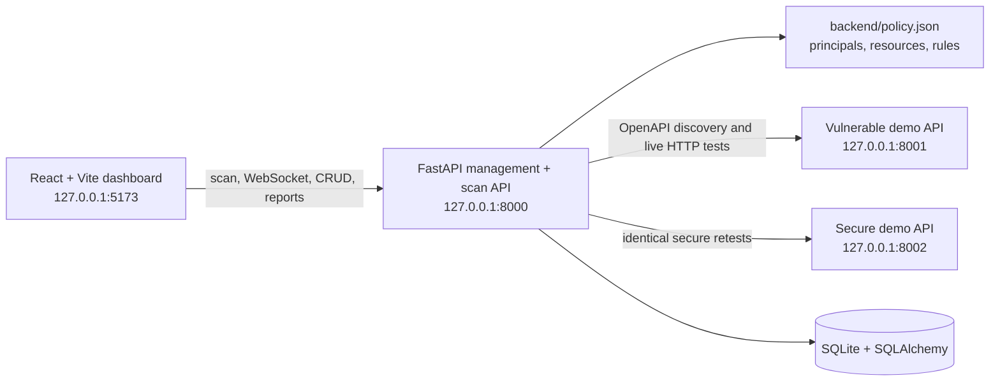

# TenantFence

**Prove the leak. Fix it. Retest it.**

TenantFence is a local API authorization assessment platform. It sends real HTTPX requests to isolated synthetic demo APIs, derives expected access from `backend/policy.json`, and requires returned foreign-tenant evidence to confirm a data leak. The same test suite can be rerun against a separate, always-secure API.


## What it does

- Builds principal/resource access expectations from policy rather than canned dashboard data.
- Lets operators scope live scans to selected tenants and resource endpoint types; secure retests replay the baseline scope.
- Discovers API routes through OpenAPI and falls back to a known route list if discovery is unavailable.
- Exercises same-tenant and cross-tenant read/write, role, list, nested, header/claim, invalid-auth, nonexistent-resource, existence-oracle, and mass-assignment cases.
- Streams actual test results over WebSockets and stores completed runs, evidence, and events in SQLite.
- Produces Markdown, HTML, and SARIF reports plus a pytest/GitHub Actions regression pack.
- Persists tenants, users, resources, access policies, scan tests, findings, evidence, events, and retest outcomes in SQLite through SQLAlchemy.
- Provides tenant, user/role, and synthetic-resource management, rule-based finding explanations, PDF reports, and a replayable WebSocket event stream.
- Includes a Settings view with resolved local API targets, policy rules, and a browser-persisted WebSocket reconnection preference.
- Limits scan targets to loopback addresses. The bundled demo data and credentials are synthetic.

## Architecture



### Main components

- `backend/vulnerable_api.py`: synthetic tenants, users, invoices, projects, documents, records, canaries, and demo vulnerability controls.
- `backend/secure_api.py`: separate secure-mode instance of the same synthetic API.
- `backend/main.py`: scan lifecycle, reconnectable WebSocket events, CRUD, retests, history, explanations, and reports.
- `backend/models.py` / `backend/database.py`: SQLAlchemy models and SQLite persistence for the security assessment entities.
- `engine/`: policy loading, route discovery, case generation, async execution, and verdict/evidence construction.
- `frontend/`: live scan dashboard, access matrix, boundary graph, findings/evidence, run history, and before/after comparison.
- `backend/tenantfence.sqlite3`: generated local history database; it is not checked in.

## Windows quickstart

Requirements: Windows PowerShell, Python 3.12, Node.js 22, and npm. From a fresh clone:

```powershell
py -3.12 -m venv backend\venv
.\backend\venv\Scripts\python.exe -m pip install -r backend\requirements.txt
npm --prefix frontend install
Copy-Item .env.example .env
.\scripts\dev.ps1
```

The launcher opens the demo API, scan engine, and Vite frontend as separate local processes. It reuses services already responding on the expected ports. Open:

- Dashboard: <http://127.0.0.1:5173>
- Scan engine docs: <http://127.0.0.1:8000/docs>
- Vulnerable demo API docs: <http://127.0.0.1:8001/docs>
- Secure demo API docs: <http://127.0.0.1:8002/docs>

Stop processes opened by the launcher by closing their terminal windows. To run components manually, use four PowerShell terminals from the repository root:

```powershell
# Terminal 1 — deliberately vulnerable synthetic API
.\backend\venv\Scripts\python.exe -m uvicorn backend.vulnerable_api:app --host 127.0.0.1 --port 8001

# Terminal 2 — independently running secure synthetic API
.\backend\venv\Scripts\python.exe -m uvicorn backend.secure_api:app --host 127.0.0.1 --port 8002

# Terminal 3 — management and scan backend
.\backend\venv\Scripts\python.exe -m uvicorn backend.main:app --host 127.0.0.1 --port 8000

# Terminal 4 — dashboard
npm --prefix frontend run dev
```

## Run and verify a scan

1. Select Company A and Company B and the invoice/document endpoint types in **Test scope**, select the vulnerable API, and run the authorization scan. The table, metrics, and timestamped WebSocket timeline update from actual responses.
2. Select a red matrix cell to inspect the exact request, response evidence, canary, reproduction command, and fix suggestion.
3. Use **Switch to secure & retest**. TenantFence sends the same policy-derived suite to the secure API on port 8002.
4. Confirm the linked before/after comparison reports matching test counts and backend-verified resolved/unresolved results.
5. Download the PDF, Markdown/HTML report, SARIF, or regression pack. The offline example is in [`docs/sample-report.md`](docs/sample-report.md).

Try the classic invoice leak manually while the API is in vulnerable mode:

```powershell
curl.exe -i http://127.0.0.1:8001/invoices/102 -H "X-User-ID: alice"
```

Alice is in `tenant_A`; invoice 102 belongs to Bob in `tenant_B`. The vulnerable API returns the synthetic canary `CANARY-B-102-x9f3`. The same request against port 8002 returns a uniform 404.

## CLI and tests

Start the demo API and scan engine as above, then run the standalone engine:

```powershell
.\backend\venv\Scripts\python.exe -m engine.run
```

The CLI exits nonzero when findings are present by default. To run in secure mode or explicitly choose a mode:

```powershell
.\backend\venv\Scripts\python.exe -m engine.run --mode secure
.\backend\venv\Scripts\python.exe -m pytest -q tests\test_engine.py
npm --prefix frontend run build
```

Dashboard API routes include scoped `POST /scan` (`tenant_ids`, `resource_types`, and optional `baseline_scan_id`), `GET /scan/{id}`, `POST /scan/{id}/stop`, `WS /ws/scans/{id}`, `GET /overview`, `GET /settings`, CRUD for tenants/users/resources, `GET /retest`, `GET /explain/{finding_id}`, `GET /report/{id}?format=pdf`, and `GET /regression/export`.

## Threat model and safety

TenantFence checks whether the API enforces the tenant boundaries described by the local policy. The bundled example includes Company A, Company B, and Company C, with Alice, Bob, and Charlie in separate tenants, plus synthetic invoices, projects, documents, records, and user resources. The vulnerable API intentionally exposes configurable authorization flaws for demonstration; do not deploy it or use it with real data. Local CRUD writes the managed policy file and reloads both API processes.

Management mutations require `X-Admin-Token`. The checked-in demo default is `local-demo-admin-token`; change it in `.env` and `frontend/.env` for a local demo. This shared browser-visible token is strictly a local demonstration convenience, not production authentication.

The scanner rejects non-loopback target URLs. Use only the bundled demo API or an explicitly configured loopback service you own and are authorized to test. No external scanning, real credentials, or real customer records are included. Evidence redacts authorization and token-like secrets; synthetic canaries are intentionally retained to prove a leak.

## Limitations

- This is a hackathon MVP, not a general-purpose DAST product or a formal security certification.
- Policy completeness and correctness determine the expected outcome; an incorrect policy can produce misleading over-restriction results.
- OpenAPI discovery and the fallback route list do not cover every API shape, authentication flow, pagination pattern, or asynchronous job.
- The bundled auth headers and vulnerabilities model common failure modes but are not a full identity provider or JWT implementation.
- Severity scores are prioritization hints, not a formal CVSS assessment.
- Regression tests replay observed requests and should be reviewed and adapted before use against a production system.
- The AI Security Explainer is explicitly rule-based; no LLM provider is called or configured. Secure retest verification requires a completed vulnerable baseline and a matching test count.
